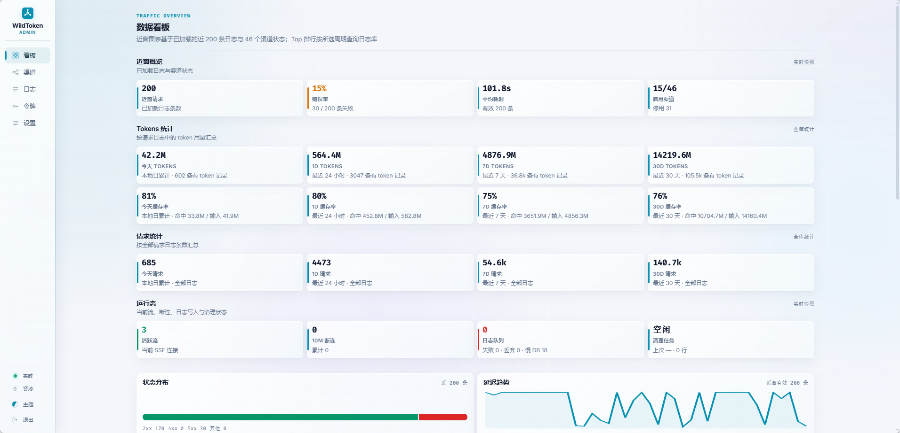
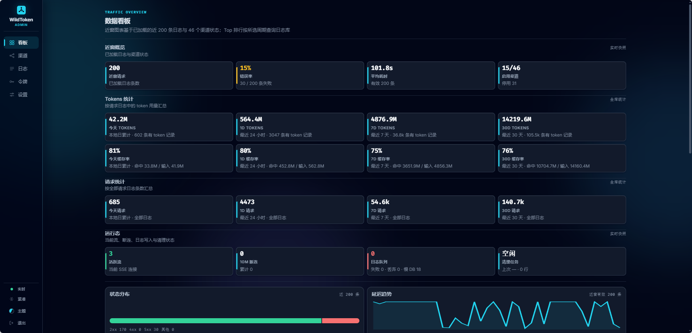
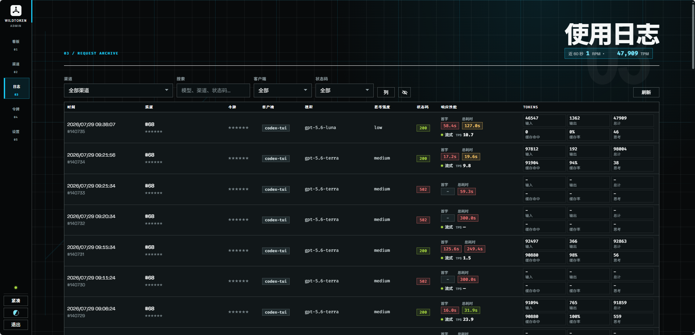

# WildToken

**🌐 语言：** [English](README.md) | 简体中文

> **使用 Go 编写的自托管 LLM API 聚合网关。**
>
> WildToken 向下游暴露 OpenAI 兼容的 `/v1/*` 接口和 Anthropic 兼容的
> `/v1/messages` 接口，再根据显式渠道、模型规则、优先级、权重和运行时健康状态，
> 把请求转发到合适的上游渠道。

如果你想用一个稳定入口管理多个 LLM 提供商、隐藏上游 Key、给不同客户端发放下游令牌、查看请求日志和 Tokens 用量，并通过网页后台日常运维，WildToken 的定位就是这类 LLM API 聚合网关。

## ⚡ 一眼看懂

| 需求 | WildToken 提供 |
| --- | --- |
| 一个客户端入口 | OpenAI 兼容 `/v1/*` 与 Anthropic 兼容 `/v1/messages` |
| 上游 Key 隔离 | 服务端保存提供商 Key，客户端只拿 WildToken 下游令牌 |
| 智能路由 | 显式渠道、模型映射、优先级、权重和健康感知故障切换 |
| 日常运维 | 后台管理渠道、令牌、日志、用量、余额和运行指标 |
| 视觉定制 | 内置浅色/深色主题，并支持 `themes/` 下的 CSS-only 主题包 |

## ✨ 特色功能

- 🔌 **OpenAI 兼容网关：** 通过一个本地入口转发 Chat Completions、Responses、模型列表、流式响应以及其他 `/v1/*` 请求。
- 🧩 **Anthropic Messages 兼容：** `POST /v1/messages` 支持标准 `x-api-key` 和 `anthropic-version` 请求头，并转发到 Anthropic 兼容上游。
- 🛣️ **多上游聚合：** 每个渠道可配置 Base URL、一把或多把上游 API Key、模型名、模型映射、模型前缀、思考强度映射和额外 Header。
- 🧭 **路由控制：** 支持 `X-WildToken-Upstream`、`?upstream=`、精确模型映射、模型名、前缀匹配、优先级分层、按权重随机和自动健康权重。
- 🔁 **重试与故障切换：** 自动路由失败后可重新选择渠道；再次选到同一渠道时遵守同渠道重试间隔。
- 🔐 **下游令牌管理：** 在后台创建客户端使用的 API Token，格式为 `sk-` 前缀加 32 位随机字母数字。完整值保存在数据库中，可在令牌列表里随时复制，也可在编辑时直接改写（旧值随即失效）。可以给令牌设有效期，填 `1d3h` 这样的时长或具体日期均可；到期后不再通过认证，记录仍保留，可随时续期。
- 🚦 **令牌与渠道限速：** 令牌和渠道都可以单独设置限速表达式，如 `100/m`、`1000/h`、`50/10s`（次数/时间窗口，单位 s/m/h/d 可带倍数）。令牌超速返回 429；渠道超速则在路由时被跳过、自动切换到下一候选渠道，全部被限时才返回 429。基于内存滑动窗口计数，重启后窗口清零。
- 📊 **管理看板：** 查看渠道状态、请求日志、Token 用量、Top 模型和渠道、延迟、运行指标以及请求/响应快照；
  统一的时间范围控件支持今天 / 24 小时 / 3 天 / 7 天 / 30 天 / 全部 / 自定义日期区间。
- 🧰 **渠道工具：** 支持拉取模型列表、测试连通性、测试指定模型，以及查询 new-api / sub2api 风格余额。
- 📦 **渠道导入导出：** 把渠道配置导出为 JSON 再导入，用于备份和跨实例迁移；导出时可选择是否包含
  API Key，导入时同名渠道可跳过或覆盖。
- 🧹 **正文保留策略：** 可以保留日志元数据，同时清理旧请求/响应正文，控制 SQLite 体积。
- 🎨 **主题包：** 后台支持 `themes/` 下的 CSS-only 主题包，不执行主题 JavaScript。
- 🖥️ **桌面运行：** Windows 使用系统托盘，macOS 桌面包使用菜单栏；CLI、Docker 和默认源码运行保持前台服务模式。

## 🖼️ 界面截图

内置浅色与深色主题下的数据看板：

| 浅色 | 深色 |
| --- | --- |
|  |  |

使用 [`themes/`](themes/) 下某个 CSS-only 主题包渲染的使用日志页：

| Ark |
| --- |
|  |

## 🚀 快速启动

### 🐳 Docker Compose

Docker Compose 是最简单的本地服务运行方式。

```bash
cp .env.example .env
# 编辑 .env，把 ADMIN_TOKEN 设置为唯一的 24-256 字节可打印 ASCII 值。
docker compose up -d --build
curl -fsS http://127.0.0.1:3100/health
```

打开管理后台：

```text
http://127.0.0.1:3100/console
```

Compose 会把 SQLite 数据保存到 `wildtoken-data` 卷，并发布 `3100` 端口。它还会把宿主机 `./themes` 只读挂载进容器，方便修改主题而不重建镜像。

更新运行中的实例请用 `scripts/deploy.sh`，别直接 `docker compose up -d --build`。脚本先构建，等进行中的请求跑完，最多 60 秒（用 `WAIT=` 调）；等不到也照换，还在跑的流会被切断（`FORCE=0` 则放弃不换）。换完核对新容器，任一步失败就换回旧镜像。

全新数据库如果监听非本机地址，必须显式设置 `ADMIN_TOKEN`，否则 WildToken 会拒绝启动。该 Token 必须是 24-256 字节、可打印 ASCII、不包含空格，且不能是 `change-me`。

### 🛠️ 源码运行

要求：

- Go 1.25 或更新版本
- CLI 无需 C 工具链：SQLite 驱动为纯 Go 实现，所有 CLI 目标均可在 `CGO_ENABLED=0` 下构建；macOS 桌面版另需 macOS SDK。

本地运行：

```bash
cp .env.example .env
# 仅本机首次启动时可不设置；暴露服务前必须设置强 Token。
ADMIN_TOKEN=replace-with-a-long-random-token go run ./cmd/wildtoken
```

源码运行默认监听 `127.0.0.1:3100`，数据库为 `sqlite:wildtoken.db?mode=rwc`。

### 🪟 Windows 桌面

发布压缩包包含 `wildtoken.exe`。双击后会以系统托盘模式启动：

- 左键单击或双击托盘图标可打开管理后台
- 托盘菜单可打开后台或退出
- 日志写入工作目录下的 `wildtoken.log`
- 需要无托盘服务模式时，可设置 `WILDTOKEN_NO_TRAY=1`，或使用 `--no-tray` / `--console`

Linux、macOS CLI 和 Docker 版本仍按前台服务方式运行。

### macOS 菜单栏应用

macOS 12 或更新版本可使用 `wildtoken-v<版本>-macos-aarch64-app.zip`（Apple Silicon）或
`wildtoken-v<版本>-macos-x86_64-app.zip`（Intel）。解压后把 `WildToken.app` 放到“应用程序”目录，双击启动。
应用只显示菜单栏图标，不占终端或 Dock；菜单提供打开管理后台、复制 API 地址、查看运行日志、打开数据目录和退出。
退出会等待现有请求和日志排空，第二个实例不会同时打开同一数据目录。

默认地址为 `http://127.0.0.1:3100/console`。未配置管理员令牌的新库首次使用 `change-me`，登录后应在设置页更换。
端口冲突、数据库或配置读取失败会弹出错误提示。

桌面版的目录固定为：

| 内容 | 位置 |
| --- | --- |
| 配置 | `~/Library/Application Support/WildToken/config/default.toml` |
| 环境变量文件 | `~/Library/Application Support/WildToken/.env`（需要时自行创建） |
| 数据库、密钥、图片和备份 | `~/Library/Application Support/WildToken/` |
| 运行日志 | `~/Library/Logs/WildToken/wildtoken.log` |
| 网页资源和内置主题 | `WildToken.app/Contents/Resources/`（只读） |

首次启动只在配置不存在时复制默认配置。更新或移动 `.app` 不会替换用户数据，也不会自动读取或迁移 CLI 的旧数据库。
相对数据库、图片和备份路径以用户数据目录为起点；默认 `themes` 指向应用内置主题，自定义主题可通过
`.env` 中的 `WILDTOKEN_THEME_DIR` 指定绝对目录。不要让 CLI 与桌面版同时打开同一数据库。

排障和手动备份可以直接使用包内程序，仍沿用桌面数据目录：

```bash
/Applications/WildToken.app/Contents/MacOS/wildtoken --console
/Applications/WildToken.app/Contents/MacOS/wildtoken backup
```

当前桌面包未配置 Developer ID 签名或 Apple 公证，首次打开可能被 Gatekeeper 拦截；下载后应先核对发布页的 `SHA256SUMS`。
暂不提供开机自启。

本地构建需 Go 1.25+、Node.js 22+ 和 Xcode Command Line Tools，在对应架构的 Mac 上执行：

```bash
npm --prefix web ci
npm --prefix web run build
scripts/package-macos.sh 0.2.5 arm64 /tmp/wildtoken-release  # Intel 使用 amd64
scripts/smoke-macos.sh /tmp/wildtoken-release/*-app.zip
```

### CLI 与大模型入口

`wildtoken` 启动服务，独立的 `wildtokenctl` 通过 HTTP 管理它。平台包同时包含客户端，macOS 应用内也提供
`Contents/MacOS/wildtokenctl`。CLI 覆盖渠道、分组、令牌、设置、模板、日志和模型接口，支持 JSON/NDJSON 输出。

有 Go 1.25+ 时，无需克隆仓库即可安装客户端和共享 skill：

```sh
go install github.com/liguangsheng/wildtoken/cmd/wildtokenctl@v0.2.5
wildtokenctl skill install --apply --yes
```

请把 `GOBIN` 加入 `PATH`；未设置 `GOBIN` 时，安装目录是 `GOPATH/bin`。
没有 Go 时，从校验过的对应平台包取出 `wildtokenctl`（Windows 为 `wildtokenctl.exe`）放进 `PATH`，再执行上面的 skill 安装命令。
客户端不依赖服务端程序或网页资源。安装 skill 不需要任何令牌；安装后 Pi 执行 `/reload`，OpenCode 重新打开会话。

常用操作：

```sh
wildtokenctl --admin-token-file /private/admin-token status --json
wildtokenctl commands --json
wildtokenctl clients pi --protocol responses --model model-id
wildtokenctl clients opencode --protocol chat --model model-id --apply --yes
wildtokenctl skill install --apply --yes
```

客户端配置默认先预览，只写入下游令牌的环境变量引用，不分发上游 Key。确认后增量合并，保留 JSONC 注释、其他 provider 和符号链接。
Skill 安装到 Pi/OpenCode 共用的 Agent Skills 目录。详见 [CLI 使用说明](docs/cli.md)。

## ✅ 首次配置

1. 打开 `/console`，使用 Admin Token 登录。
2. 创建上游渠道，填写 Base URL、提供商 API Key、模型、模型映射、优先级、权重和可选 Header 覆盖。
3. 使用渠道测试或模型测试确认上游可用。
4. 在令牌页创建下游 Token。
5. 客户端通过 `http://127.0.0.1:3100/v1/...` 调用 WildToken，使用下游 Token，不直接使用提供商 Key。

上游提供商 Key 保存在服务端渠道记录中；客户端只需要 WildToken 下游令牌。

## 🔌 API 示例

OpenAI 兼容 Chat Completions：

```bash
curl http://127.0.0.1:3100/v1/chat/completions \
  -H 'Content-Type: application/json' \
  -H 'Authorization: Bearer <DOWNSTREAM_TOKEN>' \
  -d '{
    "model": "gpt-4o-mini",
    "messages": [{"role": "user", "content": "hello"}]
  }'
```

Anthropic 兼容 Messages：

```bash
curl http://127.0.0.1:3100/v1/messages \
  -H 'Content-Type: application/json' \
  -H 'x-api-key: <DOWNSTREAM_TOKEN>' \
  -H 'anthropic-version: 2023-06-01' \
  -d '{
    "model": "claude-sonnet-4-20250514",
    "max_tokens": 128,
    "messages": [{"role": "user", "content": "hello"}]
  }'
```

本地聚合模型列表：

```bash
curl http://127.0.0.1:3100/v1/models \
  -H 'Authorization: Bearer <DOWNSTREAM_TOKEN>'
```

按名称或 ID 强制指定渠道：

```bash
curl http://127.0.0.1:3100/v1/chat/completions \
  -H 'Content-Type: application/json' \
  -H 'Authorization: Bearer <DOWNSTREAM_TOKEN>' \
  -H 'X-WildToken-Upstream: openai' \
  -d '{"model":"gpt-4o-mini","messages":[{"role":"user","content":"hello"}]}'
```

## 🧭 路由模型

WildToken 按以下顺序选择上游：

1. `X-WildToken-Upstream` 请求头或 `?upstream=` 查询参数按渠道名称或 ID 指定渠道。
2. 请求 JSON 中的 `model` 精确匹配渠道模型映射 key 或模型名。
3. 没有精确命中时，再按渠道的模型前缀匹配。列表里的模型名只是以请求名开头或结尾的，不算命中：
   请求 `gpt-4o` 不会落到只列了 `gpt-4o-mini` 的渠道。要让别名指向另一个名字，用模型映射。
4. 在启用的候选渠道中，最高 `priority` 层获胜。
5. 在同一优先级内按权重随机；开启自动权重时，有效权重为 `基础权重 * 运行时健康分`。

如果更高优先级层内所有渠道的有效权重都降为 0，WildToken 会回退到下一优先级。当渠道恢复到正权重后，高优先级层会重新接管流量。

显式指定渠道会跳过自动池选择。自动重试每次都会重新选择渠道；选到不同渠道立即重试，选回同一渠道则等待配置的同渠道重试间隔。

一个渠道可以配多把 API Key，请求按顺序轮流使用启用的 Key。某把 Key 被上游以 401、403、429 拒绝时冷却 10 秒，连续被拒每次翻倍，最长 5 分钟（上游给了 `Retry-After` 就按它，同样不超过 5 分钟）；同一个请求先换本渠道的下一把 Key，再换别的渠道。Key 全部停用的渠道退出路由；一把 Key 都没有的渠道只靠额外 Header 鉴权。控制台里已保存的 Key 默认遮住，点眼睛才取回一把，每次取回都记日志。查余额时逐把查启用的 Key，各列一节；日志页的在途请求显示正在用哪把 Key。

已存储的 Responses 响应会在 SQLite 中记录所属下游令牌、渠道和 Key。查询、取消、删除，以及带 `previous_response_id` 的续接请求沿用创建时的账户，并继续检查当前分组和模型权限；原渠道停用或凭据改变时直接报错。显式 `store: false` 不保存这份路由；升级前或网关外创建的响应没有归属记录，查询返回 404。

## 🗺️ 模型映射

模型映射允许客户端使用稳定的下游模型名，由 WildToken 在转发前改写请求体。

示例：

```text
gpt-4o-mini => provider-specific-fast-model
```

客户端仍发送 `"model": "gpt-4o-mini"`。上游收到的是 `"model": "provider-specific-fast-model"`，日志中会同时记录请求模型名和上游模型名。

`GET /v1/models` 由本地启用渠道配置聚合，返回：

- 精确 `model_names`
- `model_mappings` 的 key，也就是下游可见名称

`model_prefixes` 只是路由规则，不会展开成具体模型 ID。需要出现在 `/v1/models` 中时，请添加精确模型名或模型映射 key。

按渠道过滤模型：

```bash
curl 'http://127.0.0.1:3100/v1/models?upstream=openai' \
  -H 'Authorization: Bearer <DOWNSTREAM_TOKEN>'
```

## 🧠 思考强度映射

各家上游支持的思考强度并不一致，渠道可以把下游请求的强度改写成上游认识的那个。在渠道编辑的 **高级设置** 里配置，每行一条：

```text
max => xhigh
```

下游请求 `max`，发给该上游时变成 `xhigh`。未列出的强度原样转发，匹配不区分大小写。

请求里表达思考强度的三种写法都会被改写：顶层 `reasoning_effort`、嵌套 `reasoning.effort` 和嵌套 `output_config.effort`。强度旁边的其他字段（`thinking`、`verbosity`、`summary` 等）保持原样。

日志会同时记录三个环节：下游请求的强度、实际发往上游的强度、上游回报的强度。相邻重复的环节合并显示，所以没有发生改写时仍然只显示一个值，发生改写时显示成 `max ↳ xhigh`。

## 🧾 Header 覆盖

每个渠道可以配置静态 Header 和选定的客户端 Header 透传：

```json
{
  "User-Agent": "{client_header:User-Agent}",
  "X-Provider-Route": "premium"
}
```

渠道配置 Header 会在下游 Header、协议默认 Header 和渠道 API Key 之后应用，所以同名 Header 以渠道配置为准。

`{client_header:<Header-Name>}` 仅在下游请求存在对应 Header 时复制。它不能复制下游 `Authorization` 或 `x-api-key`，也不能覆盖 `Host`、`Content-Length`、`X-WildToken-Upstream` 等传输或内部 Header。

静态覆盖会用于正常转发、渠道测试、模型拉取、模型测试和余额查询。客户端 Header 透传只在正常转发中生效，因为只有这类请求有下游请求上下文。

## ⚙️ 配置

默认配置位于 [`config/default.toml`](config/default.toml)：

```toml
[server]
host = "127.0.0.1"
port = 3100

[database]
url = "sqlite:wildtoken.db?mode=rwc"
max_connections = 3

[upstream]
default_timeout_seconds = 300.0

[admin]
token = "change-me"

[themes]
dir = "themes"
```

配置加载顺序：

1. `config/default.toml`
2. 可选的 `config/<RUN_ENV>.toml`
3. 带 `APP__` 前缀的环境变量，例如 `APP__SERVER__PORT=3100`
4. `.env` 里的兼容变量：`ADMIN_TOKEN`、`DATABASE_URL`、`ENCRYPTION_KEY`、`WILDTOKEN_THEME_DIR`

常用环境变量：

```bash
APP__SERVER__HOST=127.0.0.1
APP__SERVER__PORT=3100
DATABASE_URL='sqlite:wildtoken.db?mode=rwc'
APP__DATABASE__MAX_CONNECTIONS=3
APP__LOGGING__LOG_QUEUE_CAPACITY=512
APP__UPSTREAM__DEFAULT_TIMEOUT_SECONDS=300
WILDTOKEN_THEME_DIR=themes
WILDTOKEN_LOG=info
```

`ADMIN_TOKEN` 只用于初始化新数据库中的管理员凭证。SQLite 里已有管理员凭证后，请在后台的“设置 -> 安全”中更换；修改 `.env` 不会轮换或重置已有凭证。

## 📈 可观测性与保留策略

管理后台包含：

- 请求、Tokens、渠道状态和运行态 KPI
- 按请求数或 Token 用量统计的 Top 模型和 Top 渠道
- 请求日志搜索和筛选
- 下游请求、上游请求、上游响应快照
- 首字延迟、总耗时、Token 数、缓存命中 Token 和提供商返回的 reasoning Token
- 服务端日志正文保留、完整日志保留和快照字节上限

日志元数据和正文快照分开存储。正文按内容切块、每块只存一份：编码工具每轮重发整段对话，相邻请求几乎完全相同，所以每条日志只为新增的那一轮付出空间；请求头等快照元数据同样只存一份。超出保留条数的日志会清掉正文，保留状态码、渠道、模型、Token 用量、延迟和 Header，不再被任何正文引用的块随后回收。保留条数最多 100,000 条，单份正文最多 128 MiB。SQLite 使用增量 vacuum，把回收释放的页还给文件系统。

## 💾 备份与恢复

WildToken 每天本地时间 05:00 备份数据库，保留最新 10 份（`backup.at`、`backup.keep`，或 `APP__BACKUP__AT`、`APP__BACKUP__KEEP`）。每份是一个 SQLite 文件，除日志正文外什么都有——正文只是滚动的排障窗口，恢复后的旧日志显示为正文已清。启动时如果最近一天没有备份，一分钟后先补一份。

- Docker Compose 写到宿主机的 `./.backup`（`BACKUP_DIR` 可改），删了数据卷备份还在。首次启动前请以自己的用户建好这个目录（`scripts/deploy.sh` 会建），否则 Docker 以 root 建，备份也归 root。
- 源码运行或 Windows 桌面版写到工作目录下的 `backups/`（`WILDTOKEN_BACKUP_DIR` 可改）。
- `wildtoken backup` 立即备份一份，服务照常运行：`docker compose exec wildtoken wildtoken backup`。

备份里的凭证用备份时的密钥加密。这把密钥（`ENCRYPTION_KEY`，或数据卷里的 `wildtoken.key`）别和备份放在一起。

Docker Compose 下恢复：

```bash
scripts/restore.sh .backup/wildtoken-20261104-050000.db
```

脚本会停容器，把被替换的库留在数据卷里，名为 `wildtoken.db.before-restore-<时间>`，再起容器并报告存储的凭证能否解开。其他部署方式：停掉服务，用备份覆盖 `wildtoken.db`。

## 🎨 主题

内置浅色/深色主题位于 `static/css/`。可选主题包位于 [`themes/`](themes/)，详见 [`themes/README.md`](themes/README.md)。

一个主题包包含 `theme.json` 清单和 CSS 文件。主题 CSS 应以 `html[data-theme="<id>"]` 为作用域，并覆盖 CSS 变量。WildToken 会把主题 CSS 作为同源静态文件加载，不执行主题包中的 JavaScript。

## 🔐 安全说明

- 在可信机器或内网之外暴露 WildToken 前，请放到 TLS 和常规网络访问控制之后。
- 非 localhost 监听必须使用强 `ADMIN_TOKEN`；暴露前请轮换遗留的 `change-me` 凭证。
- 不要把 `.env`、SQLite 数据、日志或带真实配置的发布压缩包提交到公开仓库。
- 渠道 API Key、敏感静态 Header 和控制台可复制的令牌在 SQLite 里用 AES-256-GCM 加密存储；认证走 SHA-256 摘要。
  密钥取 `ENCRYPTION_KEY`（可用 `openssl rand -hex 32` 生成）；没设时，首次启动在数据库旁生成
  `wildtoken.key`（权限 0600）。密钥别和数据库备份放在一起——Docker 部署请在 `.env` 里设
  `ENCRYPTION_KEY`，否则密钥就在数据卷里。之后再设也行，下次启动会自动换成新密钥。密钥丢了只能重填
  所有渠道 Key，请单独备份。持有管理令牌的人在控制台上照样能看到明文 Key 和令牌。
- 升级后首次启动会加密已有的明文，并做一次 `VACUUM` 清掉空闲页里的旧副本，需要约等于数据库大小的空闲磁盘。
- 提供商 API Key 只应由服务端注入上游请求，不应分发给下游客户端。
- 管理 API 同源访问并要求 `x-admin-token`；兼容性 `/v1/*` API 会为下游客户端开启 CORS。
- 管理端认证带准入控制：单个来源连续失败 5 次后按指数退避（1 秒起，最长 60 秒），
  全局每分钟失败超过 100 次则进入 30 秒冷却。已验证通过的 Token 走缓存，不受影响。
  本机来源始终豁免，避免把运维人员锁在自己的控制台外。
- 放在反向代理后面时，把 `admin.client_ip_header` 设为代理覆写的头（如 `x-forwarded-for`），
  否则所有请求会被当作同一个来源。**只有在代理确实覆写该头时才配置它** —— 该头由调用方可控，
  未经覆写就信任等于让每个调用方自选身份、随时甩掉失败记录。

## 🧪 开发检查

发布变更前常用检查：

```bash
gofmt -l cmd internal
go vet ./...
go test -race ./...
docker compose up -d --build
curl -fsS http://127.0.0.1:3100/health
docker compose ps
```

如果只修改后台 JavaScript，也应按触及文件运行仓库里的 Node 检查，例如 `node --check` 或 `tests/*.mjs` 中的主题契约测试。

## 📦 发布

推送与 `internal/handlers/admin.go` 中服务版本一致的 `v*` 标签后，GitHub Actions 会创建 Release。
发布包含原有五个平台包、Intel 与 Apple Silicon 两个 macOS `.app.zip`，以及覆盖七份归档的 `SHA256SUMS`。
CLI 包包含服务端 `wildtoken`、客户端 `wildtokenctl` 与 `static/`、`config/`、`themes/`、`web/dist/`；桌面包把程序和资源放进 `.app`。
macOS 桌面版在对应架构的 macOS runner 上原生测试、构建，并验证解压后的应用启动和退出。
